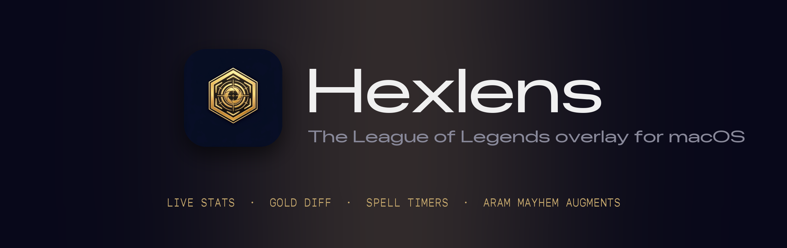
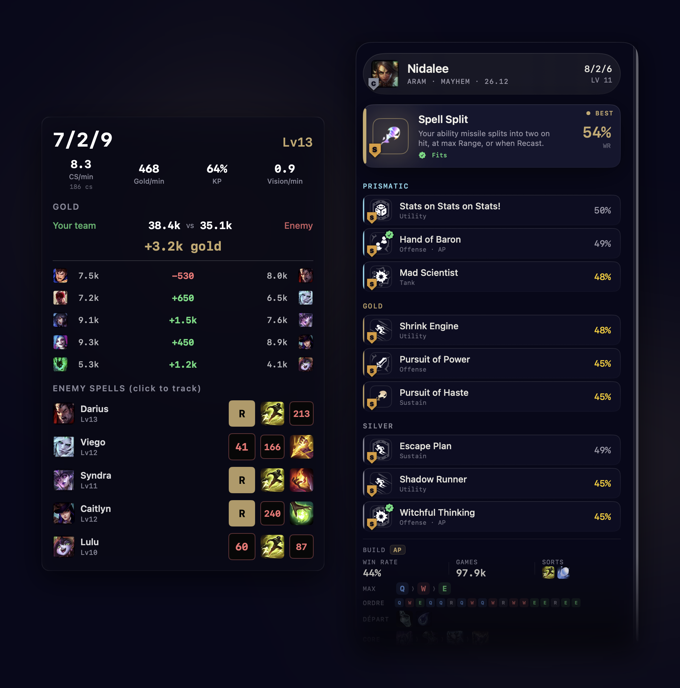
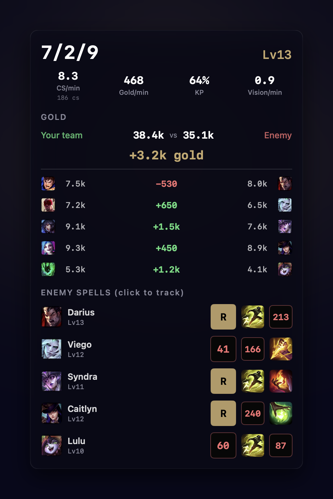
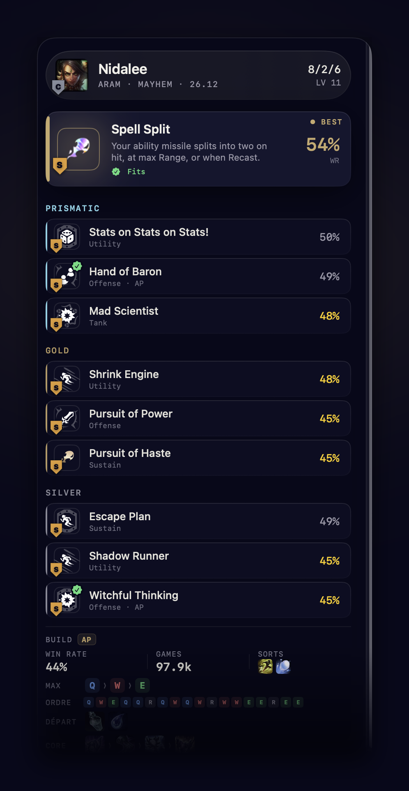
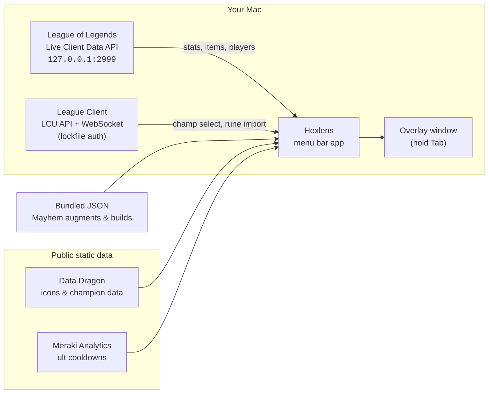

<div align="center">



<br>

**A native, lightweight League of Legends overlay for macOS.**<br>
Live stats, gold diffs, enemy cooldowns, and ARAM Mayhem augment picks, one <kbd>Tab</kbd> away.

<br>

[](https://github.com/Terzz/hexlens/releases/latest)

[](https://github.com/Terzz/hexlens/actions/workflows/test.yml)


[Features](#-features) · [Install](#-install) · [How it works](#-how-it-works) · [Build from source](#-build-from-source) · [Architecture](#-architecture) · [FAQ](#-faq)

</div>

<br>

<p align="center">
  
</p>

<p align="center"><sub>Left: Summoner's Rift overlay. Right: ARAM Mayhem augment recommender with build-aware picks.</sub></p>

<br>

## Why Hexlens

Blitz, Porofessor and friends never shipped a real macOS client. Hexlens fills that gap with a **native Swift app**: no Electron, no browser tab, no ads, no account. It sits in your menu bar, wakes up when League starts, and only appears while you hold <kbd>Tab</kbd>, the same key as the in-game scoreboard.

<table>
<tr>
<td width="33%" valign="top">

### ⚡ Native & light
Pure Swift + SwiftUI. A menu bar app with no Dock icon and no background bloat. Works in fullscreen and borderless.

</td>
<td width="33%" valign="top">

### 🔒 Private by default
Zero telemetry, zero accounts. It only talks to the game on `localhost` and to public static CDNs for icons.

</td>
<td width="33%" valign="top">

### 🎯 Built for Mac players
Hold <kbd>Tab</kbd> to show, release to hide. Click an icon to start a timer. That's the whole UX.

</td>
</tr>
</table>

<br>

## ✨ Features

### Summoner's Rift



**Your performance at a glance**
- KDA and level, front and center
- CS/min with total CS
- Gold/min, kill participation and vision/min

**Gold scoreboard**
- Team gold totals and the overall lead
- Per-lane gold matchups with champion portraits
- Lane diffs colour-coded: green when ahead, red when behind

**Enemy cooldown tracking**
- Summoner spells (Flash, TP, Ignite…) with real icons
- Ultimate tracking with per-champion base cooldowns from [Meraki Analytics](https://github.com/meraki-analytics/lolstaticdata)
- Ult cooldowns adjusted for ability haste estimated from visible items
- Click an icon when a spell is used and a countdown takes over

**Champion select**
- Build and rune recommendations
- One-click rune page import through the League Client

<br clear="right">

### ARAM Mayhem



When the game mode is **ARAM: Mayhem**, the overlay switches to a dedicated augment panel:

- **Best pick highlighted**, with its description and win rate
- Augments grouped by tier: **Prismatic**, **Gold**, **Silver**
- **Build-aware**: the ✓ badge marks augments that fit the items you're already building (AP, AD, on-hit, tank…)
- The recommended **build** for your champion: skill max order, full level-up order, starting items, core path, situational items, summoner spells and runes
- Real augment, item, spell and rune icons
- Scrolls instead of covering the minimap

<br clear="right">

### App behaviour

| | |
|---|---|
| 🧭 **Auto-detection** | Detects the League client and the start of a game. No setup. |
| ⌨️ **Tab to show** | Hold <kbd>Tab</kbd> to show, release to hide. |
| 🖱️ **Click to track** | Click a spell or ult icon to start its cooldown. |
| ↔️ **Drag to reposition** | Move the overlay anywhere; the position is saved. |
| 🔁 **Mid-game join** | Launch Hexlens after the game has started and it catches up. |
| 🛟 **Auto-reconnect** | Exponential backoff whenever the game API drops. |
| 🔐 **Guided permissions** | A built-in panel walks you through the Accessibility permission. |
| 🐞 **Copy Debug Info** | One click in the menu bar for bug reports. |

<br>

## 📦 Install

### Option 1: Download (recommended)

1. Grab the latest `Hexlens-x.y.z.dmg` from **[Releases](https://github.com/Terzz/hexlens/releases/latest)**.
2. Drag **Hexlens** into **Applications** and launch it.
3. Grant **Accessibility** when prompted. macOS requires it to detect <kbd>Tab</kbd> while League has focus.
4. Start a game, hold <kbd>Tab</kbd>.

> [!TIP]
> Set League to **Borderless** or **Fullscreen**. The overlay floats above both.

### Option 2: Build it yourself

See [Build from source](#-build-from-source) below.

### Requirements

- macOS **14 Sonoma** or later (Apple Silicon or Intel)
- League of Legends for macOS

<br>

## 🧠 How it works

Hexlens reads only what League already exposes on your own machine, plus public static data.



| Source | Used for |
|---|---|
| **Live Client Data API** (local) | KDA, CS, gold, items, levels, game mode |
| **League Client API** (local) | Champion select session, rune page import |
| **Data Dragon** (Riot CDN) | Champion, item, spell and rune icons; champion metadata |
| **Meraki Analytics** | Per-champion ultimate cooldowns, updated every patch |
| **Bundled JSON** | ARAM Mayhem augment catalogue, stats and builds, generated by [`data-pipeline/`](data-pipeline) |

<br>

## 🛠 Build from source

```bash
git clone https://github.com/Terzz/hexlens.git
cd hexlens/desktop
swift build -c release
open .build/release/MacLeagueOverlay
```

To package a double-clickable, ad-hoc signed `Hexlens.app` with its icon:

```bash
./scripts/make-app.sh
open Hexlens.app
```

### Demo mode (no game needed)

The overlay can run on mock game data, which is handy for UI work and screenshots:

```bash
cd desktop
.build/release/MacLeagueOverlay --demo           # ARAM Mayhem · Nidalee, AP build
.build/release/MacLeagueOverlay --demo yi        # ARAM Mayhem · Master Yi, on-hit build
.build/release/MacLeagueOverlay --demo classic   # Summoner's Rift, mid-game
```

### Tests

```bash
cd desktop
swift test
```

90 unit tests cover lockfile parsing, Live Client decoding, the timer engine, spell cooldowns, CS benchmarks, champ select data and augment recommendations. They run on every push via GitHub Actions.

<br>

## 🏗 Architecture

```
hexlens/
├── desktop/                     Native macOS app (Swift Package)
│   ├── Sources/
│   │   ├── App/                 App lifecycle, menu bar, onboarding, permissions, settings
│   │   ├── Overlay/             Overlay window + SwiftUI views (Rift & Mayhem)
│   │   ├── ChampSelect/         Champion select panel
│   │   ├── API/                 Live Client, LCU, Data Dragon, patch & augment data
│   │   ├── Services/            Game detection, state manager, spell tracker, timers
│   │   ├── Models/              Game state & API models
│   │   └── Resources/           Bundled Mayhem data (augments, builds, runes)
│   └── Tests/                   XCTest suites
├── data-pipeline/               Python scripts that build the bundled Mayhem JSON
├── web/                         Next.js + Tailwind landing page
├── scripts/                     make-app.sh, icon generation
├── docs/assets/                 README visuals
└── .github/workflows/           CI tests + signed & notarized DMG releases
```

**Stack:** Swift 5.9 · SwiftUI + AppKit · [Starscream](https://github.com/daltoniam/Starscream) (LCU WebSocket) · Python 3 (data pipeline) · Next.js (site)

**Releases:** pushing a `v*` tag builds a release, then code-signs, notarizes and staples a `.dmg` before publishing it to GitHub Releases ([`release.yml`](.github/workflows/release.yml)).

<br>

## 🔄 Updating Mayhem data

The augment catalogue and builds are generated offline and bundled into the app:

```bash
cd data-pipeline
python3 mayhem_pipeline.py --refresh   # re-download sources (run each patch)
python3 mayhem_pipeline.py --verify    # build + print sample recommendations
```

See [`data-pipeline/README.md`](data-pipeline/README.md) for the sources and the scoring heuristic.

<br>

## ❓ FAQ

<details>
<summary><b>Can I get banned for using Hexlens?</b></summary>
<br>
Hexlens does not read game memory, inject code or automate input. It reads Riot's own local APIs (Live Client Data and League Client), the same way established companion apps do. Riot's <a href="https://support-leagueoflegends.riotgames.com/hc/en-us/articles/225266848-Third-Party-Applications">Third Party Application policy</a> still applies, so use it at your own discretion.
</details>

<details>
<summary><b>Why does it need the Accessibility permission?</b></summary>
<br>
macOS only lets an app see <kbd>Tab</kbd> presses while another app (League) has focus if it has Accessibility access. Hexlens uses it for that key alone.
</details>

<details>
<summary><b>The overlay doesn't show up.</b></summary>
<br>
Check that League runs in <b>Borderless</b> or <b>Fullscreen</b>, that Accessibility is granted (menu bar → Permissions), and that a game has actually loaded. The Live Client API only exists once you're on the map. If it still fails, use <b>Copy Debug Info</b> from the menu bar and open an issue.
</details>

<details>
<summary><b>Does it collect any data?</b></summary>
<br>
No. There are no analytics, no accounts and no remote server. The only network calls fetch public static assets (icons, cooldown data).
</details>

<br>

## 🤝 Contributing

Issues and pull requests are welcome.

1. Fork the repo and create a branch: `git checkout -b feat/my-feature`
2. Make your changes; keep `swift test` green
3. For UI work, follow [`DESIGN.md`](DESIGN.md) (warm navy, LoL gold, monospace for data)
4. Open a pull request with a screenshot (`--demo` makes that easy)

<br>

## 🙏 Credits

- Original project by **[@a29paul](https://github.com/a29paul/hexlens)**. ARAM Mayhem recommender, permissions onboarding and data pipeline by **[@Terzz](https://github.com/Terzz)**.
- Static game data: [Data Dragon](https://developer.riotgames.com/docs/lol#data-dragon), [CommunityDragon](https://www.communitydragon.org/) and [Meraki Analytics](https://github.com/meraki-analytics/lolstaticdata).

<br>

## 📄 License

[MIT](LICENSE)

<br>

<div align="center">
<sub>Hexlens isn't endorsed by Riot Games and doesn't reflect the views or opinions of Riot Games or anyone officially involved in producing or managing Riot Games properties. Riot Games and all associated properties are trademarks or registered trademarks of Riot Games, Inc.</sub>
</div>
